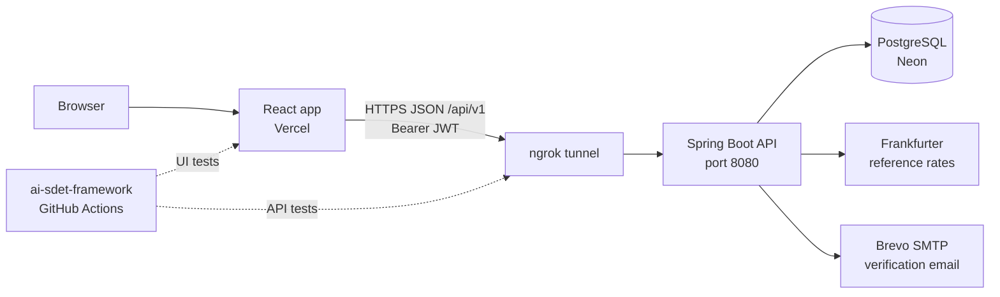
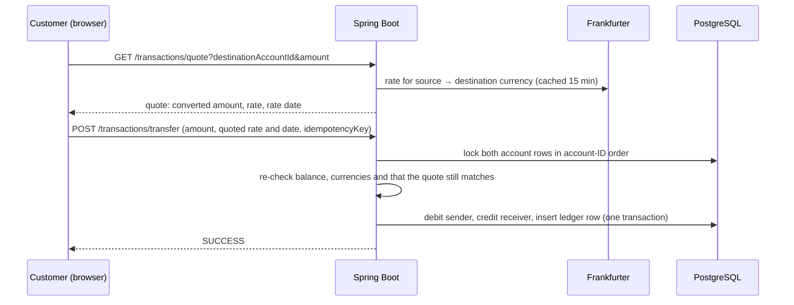

# Universal Bank

A full-stack demo banking application: customers sign up, verify their email, and send money to each other across four currencies with live reference exchange rates; an administrator funds a central vault, opens accounts and credits customers. Every balance change is a locked, idempotent database transaction recorded in a ledger.

**Live frontend:** https://universal-bank.vercel.app (the API runs on demand, so it may be offline)
**Automated tests:** [rashid262/ai-sdet-framework](https://github.com/rashid262/ai-sdet-framework), Playwright + Cucumber UI and API suite with GitHub Actions CI

**Stack:** React 19 · Vite 7 · React Router 7 · Java 21 · Spring Boot 3.2 · Spring Security (JWT) · Spring Data JPA · PostgreSQL (Neon) · Brevo SMTP · Frankfurter FX API · Vercel · ngrok

> This is a learning and demo project, not a real bank. Exchange rates are daily reference rates, the vault balance is an admin-entered demo entry, and the security setup is not meant for real money.

## Features

| Customer | Administrator |
| --- | --- |
| Self-registration with currency choice (INR, USD, CNY, JPY) | Record an opening balance in the system vault `UB-0000` |
| Email verification before first sign-in | Open customer accounts; a temporary password is emailed |
| Balance, account summary and transaction history | Credit a customer from the vault, with an FX quote for other currencies |
| Pay another customer, with a cross-currency quote to confirm | Global ledger of every posting |
| Change password | Admin password recovery through configuration |

## Architecture



- The **frontend** is a static Vite build hosted on Vercel. It never talks to the database; it calls the REST API at `VITE_API_URL`.
- The **backend** runs on the developer's machine and is exposed to the internet through an **ngrok** HTTPS tunnel, so the Vercel site and the CI test runner can reach it. A `Dockerfile` is included for hosting it on a container platform instead.
- The **database** is PostgreSQL hosted on **Neon**. A local PostgreSQL 17 can be used instead by changing `SPRING_DATASOURCE_URL`.

### What happens on a payment



## Money movement rules

1. Only the vault `UB-0000` can put money into customer accounts; customers have no deposit or withdrawal.
2. Vault funding is an explicit admin "opening balance" entry, recorded as `VAULT_FUNDING`.
3. An admin credit debits the vault and credits the customer, converting currency when they differ.
4. A customer can only pay **from their own account** (taken from the JWT, never from the request) **to a different verified customer**.
5. Every credit and transfer needs a positive amount and a unique idempotency key, so a repeated request cannot move money twice.
6. Balances change inside a database transaction with pessimistic row locks, so concurrent requests cannot overspend.
7. Cross-currency postings are rejected if the rate or rate date the user saw no longer matches the server's quote.

## Repository structure

```text
Banking Application/
├── backend/                      Spring Boot API (Java 21, Maven)
│   ├── src/main/java/com/bank/transaction/
│   │   ├── controller/           REST endpoints
│   │   ├── service/              Auth, accounts, transfers, FX
│   │   ├── domain/               JPA entities: User, Account, Transaction, CurrencyCode
│   │   ├── repository/           Spring Data JPA, row locking, idempotency queries
│   │   ├── security/             JWT creation and request filter
│   │   ├── config/               Security chain, CORS, vault/admin bootstrap
│   │   ├── dto/  enums/  exception/
│   │   └── TransactionServiceApplication.java
│   ├── src/main/resources/application.yml
│   ├── src/test/java/            JUnit 5 + Mockito service tests
│   ├── .env.example              Copy to .env and fill in
│   └── Dockerfile                Container build for hosting
├── frontend/                     React app (Vite)
│   ├── src/pages/                Login, Register, VerifySuccess, AdminDashboard, CustomerDashboard
│   ├── src/components/           App shell, route guards, form fields, notices
│   ├── src/lib/                  Session storage, money and date formatting
│   ├── src/api.js                Fetch wrapper, adds the Bearer token
│   ├── .env.example
│   └── vercel.json               SPA routing on Vercel
├── scripts/stop-bank.ps1         Stops ngrok, backend, frontend and local PostgreSQL
├── stop-bank.cmd                 Shortcut for the script above
├── .vscode/tasks.json            One-click tasks to start database, backend, frontend
└── APPLICATION_KNOWLEDGE.md      Detailed notes, QA history and local workflow
```

## Run it locally

**Prerequisites:** JDK 21, Node.js 20+, a PostgreSQL database (Neon or local), and optionally ngrok and a Brevo account for email.

### 1. Configure

```bash
cp backend/.env.example backend/.env
cp frontend/.env.example frontend/.env
```

Fill in `backend/.env`:

| Variable | Purpose |
| --- | --- |
| `SPRING_DATASOURCE_URL`, `SPRING_DATASOURCE_USERNAME`, `SPRING_DATASOURCE_PASSWORD` | Database connection (Neon gives you a JDBC URL) |
| `JWT_SECRET` | Token signing key, at least 32 bytes. The app will not start without it |
| `ADMIN_INITIAL_PASSWORD` | Password for the bootstrap `admin` user, at least 12 characters |
| `APP_BASE_URL` | Public URL of the backend, used in verification email links |
| `FRONTEND_URL` | Where the verification link redirects after success |
| `CORS_ALLOWED_ORIGINS` | Browser origins allowed to call the API, e.g. your Vercel URL |
| `BREVO_SMTP_LOGIN`, `BREVO_SMTP_KEY`, `MAIL_FROM` | Email sending; `MAIL_FROM` must be a verified sender |
| `ADMIN_PASSWORD_RESET` | Set `true` once with a new admin password to recover access, then back to `false` |

`frontend/.env` needs only `VITE_API_URL`, the backend origin without `/api/v1` (for example `http://127.0.0.1:8080`). Never put secrets in frontend variables: Vite ships them to the browser.

### 2. Start

From VS Code: **Terminal → Run Task** → `Backend: Spring Boot`, then `Frontend: Vite` (and `Database: PostgreSQL (local)` first if you use a local database).

Or manually:

```bash
# backend (from backend/, so .env is found)
./mvnw spring-boot:run          # Windows: mvnw.cmd spring-boot:run

# frontend (from frontend/)
npm install
npm run dev -- --host 127.0.0.1
```

Open http://127.0.0.1:5173 and sign in as `admin` with your `ADMIN_INITIAL_PASSWORD`. Record a vault opening balance first, then open customer accounts or register customers.

### 3. Expose it (for the Vercel site and the test pipeline)

```bash
ngrok http --url=<your-ngrok-domain> 8080
```

Then set, and redeploy where needed:
- Vercel: `VITE_API_URL=https://<your-ngrok-domain>`
- `backend/.env`: `APP_BASE_URL=https://<your-ngrok-domain>`, `CORS_ALLOWED_ORIGINS` including `https://universal-bank.vercel.app`

To stop everything: `stop-bank` from the project root (`stop-bank -DryRun` to preview).

## API reference

All routes are under `/api/v1`. Responses use `{ "status": "SUCCESS" | ..., "message": "...", "data": { ... } }`. Authenticated routes need `Authorization: Bearer <token>`; tokens expire after one hour.

| Method and route | Access | Purpose |
| --- | --- | --- |
| `POST /auth/register` | Public | Register a customer and send a verification email |
| `GET /auth/verify?token=` | Public | Verify the email, then redirect to the frontend |
| `POST /auth/login` | Public | Sign in and receive a JWT |
| `POST /auth/change-password` | Signed in | Change password |
| `POST /accounts` | Admin | Open a customer account |
| `GET /accounts/{id}/balance` | Owner or admin | Balance and account details |
| `GET /accounts/{id}/transactions` | Owner or admin | Account history |
| `GET /accounts/{id}/credit-quote?amount=` | Admin | Quote a vault credit, with FX |
| `POST /accounts/{id}/credit` | Admin | Credit a customer from the vault |
| `POST /admin/vault/fund` | Admin | Record a vault opening balance |
| `GET /admin/transactions/all` | Admin | Global ledger |
| `GET /transactions/quote?destinationAccountId=&amount=` | Customer | Quote a payment |
| `POST /transactions/transfer` | Customer | Pay another customer |
| `GET /health` | Signed in | Health check |

Quote responses include `sourceCurrency`, `destinationCurrency`, `sourceAmount`, `destinationAmount`, `exchangeRate`, `rateDate`, `rateProvider` and `fetchedAt`. Cross-currency postings send back `quotedExchangeRate` and `quotedExchangeRateDate` with an `idempotencyKey`.

## Currencies and exchange rates

- Supported: INR, USD and CNY (2 decimals), JPY (whole yen).
- Rates come from Frankfurter's daily reference rates, fetched by the backend and cached per pair for 15 minutes. Same-currency moves use rate 1.
- Converted amounts are rounded half-up to the destination currency's precision.
- If the rate provider is unavailable, money movement fails rather than guessing a rate.

## Security

- Passwords are hashed with BCrypt; accounts must be email-verified before sign-in.
- Brute-force protection: per-IP limits on the public auth endpoints (30 sign-ins per minute; 5–10 per hour for endpoints that send email or reset passwords), answered with HTTP 429 and `Retry-After`. After 5 wrong passwords a username is locked for 15 minutes, whether or not it exists. Behind ngrok, the client IP comes from `X-Forwarded-For`, trusted only for requests from the local tunnel. Counters are in memory (single instance).
- Stateless JWT authentication with `ROLE_ADMIN` and `ROLE_CUSTOMER`; the API checks that customers only read their own accounts.
- The frontend route guards are for user experience only; the API is the security boundary.
- Secrets live in `backend/.env` (git-ignored), never in the repository or the frontend.

## Testing

**Backend unit tests** (JUnit 5, Mockito), from `backend/`:

```bash
./mvnw test
```

They cover FX parsing, caching and currency rules; transfer and vault-credit balance changes; stale-quote rejection; insufficient funds; idempotency; and application start-up.

**Frontend checks**, from `frontend/`: `npm run lint` and `npm run build`.

**End-to-end tests** live in a separate repository, [ai-sdet-framework](https://github.com/rashid262/ai-sdet-framework): Cucumber scenarios drive the live Vercel site with Playwright and call the API directly, covering sign-in and access control, form validation, cross-currency payments, admin vault operations and API authorization. They run in GitHub Actions on every push (smoke) and nightly (full suite).

## Known limitations

- Not a real bank: no settlement, KYC, limits, disputes or reconciliation.
- The vault opening balance is a demo ledger entry, not real reserves.
- Reference FX rates only, not executable customer rates.
- No JWT key rotation; changing `JWT_SECRET` signs everyone out.
- JWTs are stored in `localStorage`, so XSS prevention matters.
- Schema is managed by Hibernate `ddl-auto: update`; a real deployment needs versioned migrations.
- The API is only reachable while the developer's machine, backend and ngrok are running.

More detail on design decisions, local setup history and QA notes: [`APPLICATION_KNOWLEDGE.md`](APPLICATION_KNOWLEDGE.md).
